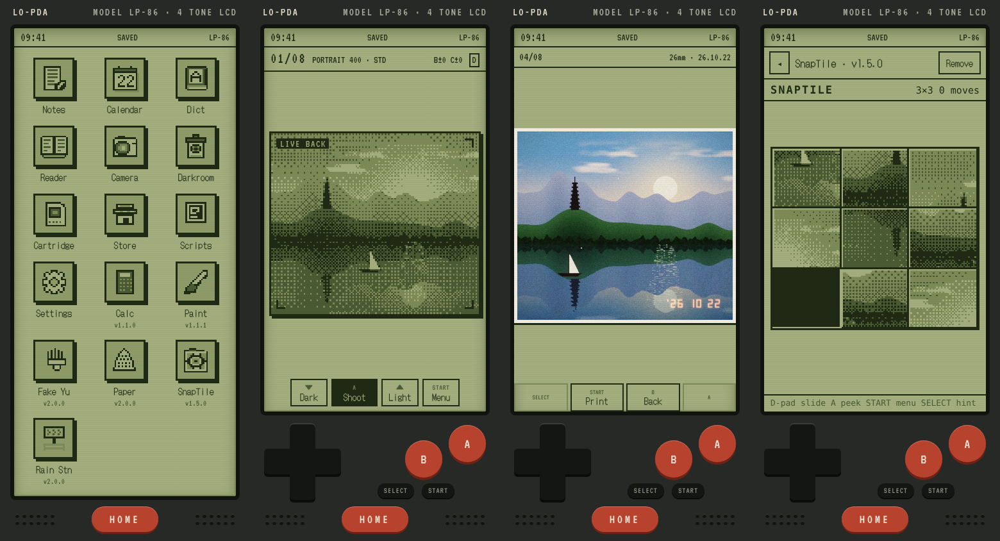
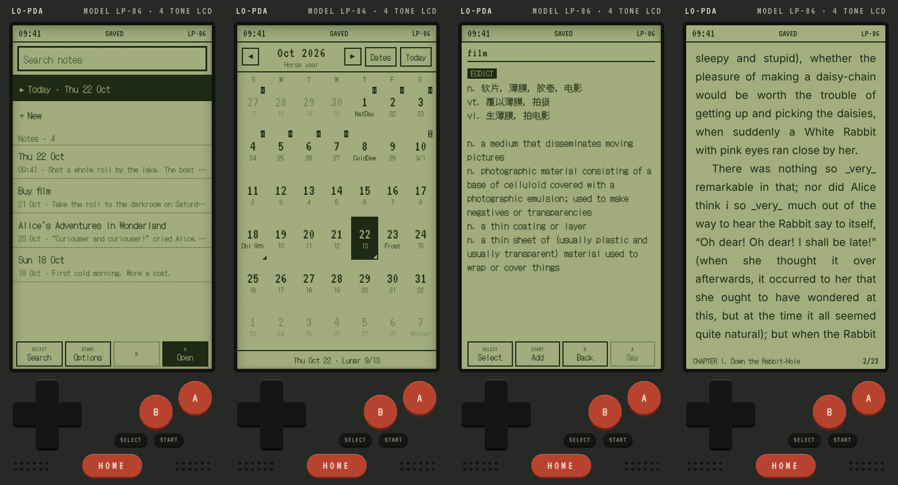
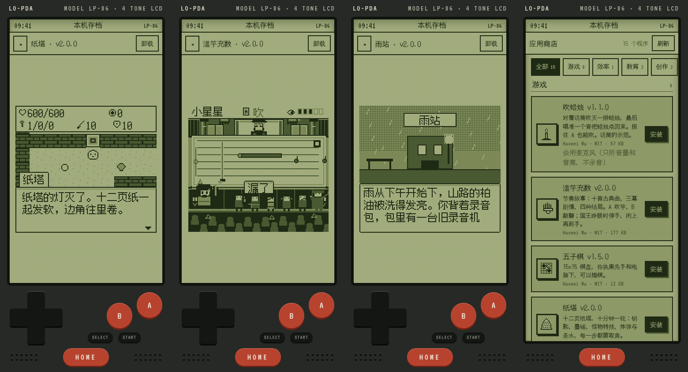

# Lo-PDA

A four-tone handheld that lives on your phone. Hi-PDA's low-fidelity cousin.

一台住在手机里的四色掌机，Hi-PDA 的低保真表亲。

**Try it:** https://nowheremanx.github.io/lopda/ — open it on a phone and "Add to Home Screen".



Lo-PDA is a Progressive Web App styled as a fictional 1986 PDA: a green LCD that shows four tones and nothing else,
a D-pad, A and B, SELECT and START on its chin, and a HOME key. It comes with a film camera and a darkroom, a diary,
a calendar, a dictionary, a book reader, a cartridge player and a store of small community apps. Everything runs
and is saved on the phone. There are no accounts, no ads and no tracking, and it works offline.

## Shot on Lo-PDA

The camera behaves like a film camera. You load a roll of 8, 12 or 16 frames in one of seven film stocks
(Portrait 400, Sunny 200, Verde 400, Pastel 400, Tungsten 800T, Noir 400, Expired). The viewfinder is a live
four-tone dither and there is no preview: you don't see what you shot until the roll is developed. A finished
roll goes into the darkroom's film box.

In the darkroom each roll is developed once, in colour, with the stock's look, grain, halation, the odd light leak
and a date stamp in the corner. The photo viewer is the only place where the LCD shows colour, like a print laid
on the glass. Prints leave the handheld as a single print, a contact sheet or a film strip; a roll can also leave
as a four-tone negative PNG that carries the colour originals inside, and come back in later.


## What's inside



| Built-in | 内置 | What it does |
|---|---|---|
| Notes | 记事本 | Opens on today's diary, with "on this day" from earlier years. Tags from `#words`, search, pins, a trash kept 30 days, a zip of Markdown files out and back in. |
| Calendar | 万年历 | Gregorian and lunar calendar with solar terms, 1900–2100, China's public holidays and days off, your own anniversaries. Days with a diary get a folded corner. |
| Dictionary | 词典 | English–Chinese, built in and offline (abridged ECDICT). Import StarDict dictionaries; a word book for review; A says the word aloud. |
| Reader | 阅读器 | TXT and EPUB books, your own fonts, an e-ink style full refresh. Select text to look it up or quote it into Notes. Two public-domain books included. |
| Camera | 点阵相机 | Live dithered viewfinder, rolls of film, seven stocks, every lens on the phone. |
| Darkroom | 冲洗店 | The film box: develop, view in colour, print, export and import negatives. |
| Cartridge | 卡带机 | Plays black-and-white Game Boy files you supply, with the chin buttons. Saves can be exported and imported. No games are included. |
| Store | 应用商店 | Install, update and run community apps, by category. |
| Scripts | 脚本 | Your own small HTML/JS programs: copy a prompt for an AI, paste the code back, run it in the sandbox. |
| Settings | 设置 | Sound, volume, language (中文 / English), which apps may use the sensors and camera, backup and restore of the whole device, updates. |

## The app store



Fifteen apps today, all open source and all made for Lo-PDA:

| Kind | Apps |
|---|---|
| Games | Paper Tower (a ten-minute tower climb), Fake Yu (a one-key rhythm story), SnapTile (a sliding puzzle from your own photo), Marble (tilt the phone), Candles (blow into the mic), Gomoku, Mole Bop, Pagoda (a 3D prologue) |
| Story | Rain Station, a visual novel with seven chapters and five endings |
| Tools and toys | Calc and Paint (both preinstalled), Fortune, Kana, Sounds, VecDream |

Preinstalled apps are ordinary store apps: remove them and they stay removed; the store has them again.

## Make an app / 做一个 app

An app is one HTML file of up to 512 KB and a `manifest.json`. It runs in a sandboxed iframe with no network
and no storage of its own, and talks to the handheld through a small `PAD` object:

| | What an app can use |
|---|---|
| Always | The buttons, 256 KB of saved data, named sounds, chip music in MML, custom sound effects, ambience (rain, waves, fire…), the language, `PAD.say` to speak a line |
| With a permission | `files` (export and import one file), `motion` (tilt and shake), `mic` (loudness and pitch, never the recording), `notes` (write into Notes), `camera` (one four-tone photo through the handheld's own viewfinder) |

Every permission is asked by the handheld itself, not by the app, and the player can say no; apps must still work
with the keys. The full rules are in [`SPEC.md`](SPEC.md) (spec `lopda/1`); the screen layout rules are in
[`sdk/UI.md`](sdk/UI.md).

```sh
cp -r sdk/template registry/apps/my-app       # then edit manifest.json: "id": "my-app"
python3 -m http.server 8086                   # from the repository root
# open http://localhost:8086/sdk/dev.html?app=registry/apps/my-app
node tools/check-app.mjs registry/apps/my-app
node tools/build-index.mjs
```

- Writing with an AI assistant: [`sdk/PROMPT.md`](sdk/PROMPT.md) is a ready-made prompt.
- Games: [`sdk/lo-game.js`](sdk/LO-GAME.md) has a pixel font, dialogue boxes, menus and tile maps; start from
  `sdk/template-game/`, or `sdk/template-vn/` for a visual novel. 3D: [`sdk/lo-3d.js`](sdk/LO-3D.md).
- The online harness loads any registry app with buttons and a log, nothing to install:
  `https://nowheremanx.github.io/lopda/sdk/dev.html?app=registry/apps/<id>`.
- To submit, open a pull request; [`CONTRIBUTING.md`](CONTRIBUTING.md) has the steps in English and Chinese, and
  [`docs/REVIEW.md`](docs/REVIEW.md) says what a review looks for. 完整双语步骤和投稿清单见 CONTRIBUTING.md。

## Your data

Everything stays in the phone's browser storage. Settings → Backup writes the whole device (notes, rolls and their
colour originals, books, dictionaries, cartridge saves, app data) into one `lopda-backup-YYYYMMDD.zip`, and Restore
puts it back after checking it first. The only built-in that goes online is the calendar, which fetches next year's
table of China's holidays from jsDelivr when it is missing (the tables up to now ship with the app). Apps cannot reach the network at all.

## Run it locally

Any static file server at the repository root works, because the runtime loads `../sdk/` and `../registry/`:

```sh
cd lopda
python3 -m http.server 8086
# open http://localhost:8086/runtime/
```

On a phone, open the runtime over **HTTPS** and use "Add to Home Screen". Plain `http://<your-computer-ip>:8086`
works for a quick look, but browsers disable the live camera, offline mode and the share sheet on insecure origins.
Two easy ways to get HTTPS while developing:

```sh
# a temporary public https URL, no account needed
brew install cloudflared
cloudflared tunnel --url http://localhost:8086
# then open https://<random>.trycloudflare.com/runtime/ on the phone
```

or publish the repository with GitHub Pages.

`node --test` runs the test suite (no dependencies). `node tools/readme-shots.mjs` makes the pictures in this README
(it needs Playwright).

## Layout

```
runtime/     the PWA: index.html, core.js, apps/ (one file per built-in), boot.js, strings.js, platform.js, sw.js, fonts, vendor
sdk/         MIT: PAD bridge, lo-game.js, lo-3d.js, templates, dev harness, AI prompts
registry/    index.json + apps/<id>/{manifest.json,index.html}
tools/       check-app.mjs, build-index.mjs, bundle-app.mjs, readme-shots.mjs (Node 20+, no dependencies)
tests/       run with `node --test`
docs/        decisions.md (why things are the way they are), design notes, review rules
SPEC.md      app specification lopda/1
```

## Design rule

Every change should take a decision away from the user, or at least not add one. Four tones, fixed frame counts,
no previews, one development per roll, frames you can't edit. The limits are the point.
Why things are the way they are: [`docs/decisions.md`](docs/decisions.md).

<sub>The screenshots were made in a desktop browser by `tools/readme-shots.mjs`, with the camera fed a lake drawn in code.</sub>

## License

[MIT](LICENSE). Copyright (c) 2026 Haowei Wu.

Every registry app uses a permissive license of its author's choice. Third-party parts (fonts, the Game Boy core,
the dictionary data, the holiday table) keep their own permissive licences, listed in `LICENSING.md` and `NOTICE`.
The name "Lo-PDA" and its icons are not covered by the license: forks published for others need their own name.
