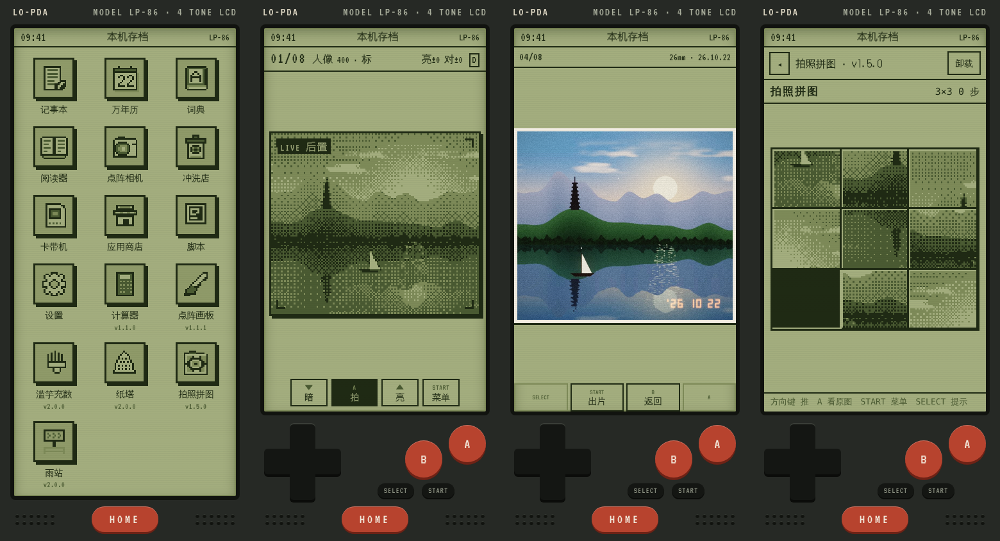
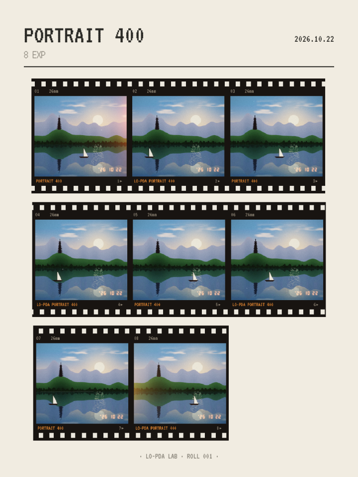
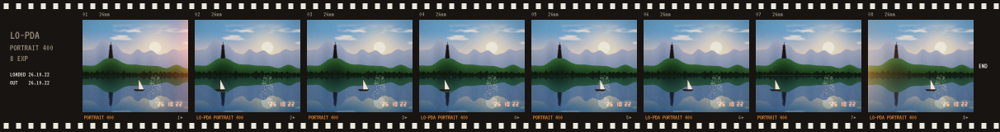
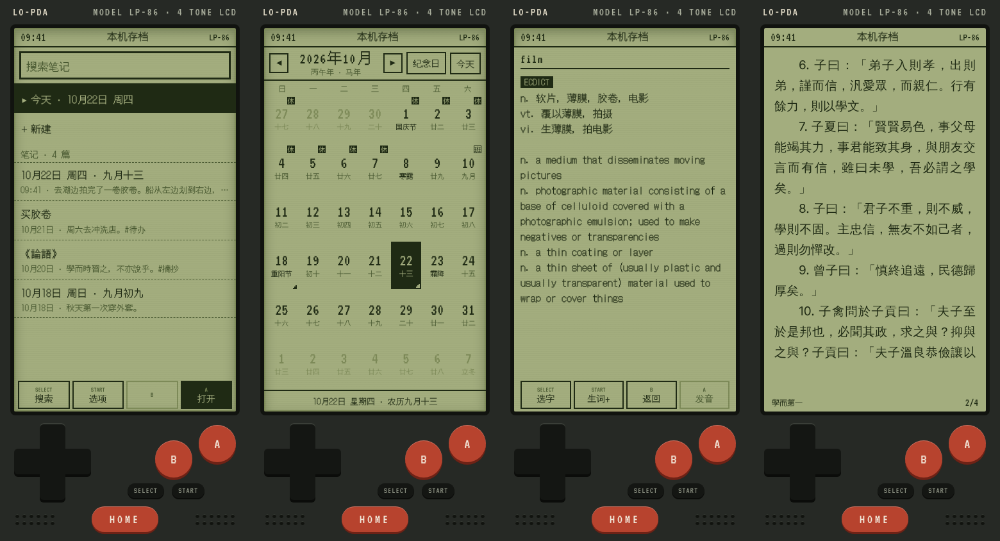
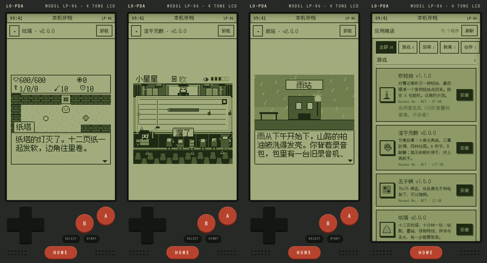

# Lo-PDA

一台住在手机里的四色掌机，Hi-PDA 的低保真表亲。

**[English →](README.md)**

**在线试玩：** https://nowheremanx.github.io/lopda/ （用手机打开，再选「添加到主屏幕」）



Lo-PDA 是一个渐进式网页应用（PWA），样子是一台虚构的 1986 年掌机：一块只有四种颜色的绿色液晶屏，
下巴上有十字键、A、B、SELECT、START，还有一个 HOME 键。里面有胶片相机和冲洗店、日记、万年历、词典、
阅读器、卡带机，还有一个放社区小程序的应用商店。所有东西都在手机上运行、存在手机上：
不用注册，没有广告，没有统计，离线也能用。

## 用 Lo-PDA 拍的

相机照胶片相机的规矩来。装一卷 8、12 或 16 张的胶卷，七种胶片任选一种
（人像 400、暖阳 200、青绿 400、樱 400、夜 800T、黑白 400、过期）。取景器是实时的四色点阵，没有回看：
冲洗之前你不知道拍成了什么样。拍完的胶卷取出来，放进冲洗店的胶卷盒。

每卷胶卷在冲洗店里只冲一次，冲出来是彩色的：有这种胶片的色调、颗粒、高光晕，偶尔漏光，角上印着日期。
看片的时候是整台掌机唯一显示彩色的地方，像把相片放在玻璃上看。相片可以导出成单张、接触印相或胶片条；
整卷也可以导出成一张四色底片 PNG，里面带着彩色原片，以后还能导回来。





## 里面有什么



| 内置程序 | 做什么 |
|---|---|
| 记事本 | 一打开就是今天的日记，还有「那年今日」。`#标签`、搜索、置顶、保留 30 天的回收站；可以把全部笔记打包成 Markdown 文件导出，也能导回来。 |
| 万年历 | 公历、农历和节气（1900–2100），国家法定节假日和调休，自己加的纪念日。写过日记的日子有一个折角。 |
| 词典 | 英汉词典，内置、离线（精简版 ECDICT）。可以导入 StarDict 词典；生词本可以复习；按 A 读出单词。 |
| 阅读器 | 看 TXT 和 EPUB，可以用自己的字体，有墨水屏式的全屏刷新。选中文字可以查词，也可以摘抄进记事本。自带两本公版书。 |
| 点阵相机 | 实时点阵取景器、胶卷、七种胶片，手机上的每个镜头都能用。 |
| 冲洗店 | 胶卷盒：冲洗、看彩色照片、出片、导出和导入底片。 |
| 卡带机 | 玩你自己提供的黑白 Game Boy 文件，用下巴上的按键。存档可以导出、导入。不带任何游戏。 |
| 应用商店 | 按分类安装、更新、运行社区小程序。 |
| 脚本 | 你自己的 HTML/JS 小程序：复制一段给 AI 的提示词，把它写的代码粘回来，在沙盒里运行。 |
| 设置 | 声音、音量、语言（中文 / English）、哪些 app 能用传感器和相机、整机备份和恢复、检查更新。 |

## 应用商店



现在有 16 个，全部开源，都是给 Lo-PDA 做的：

| 类型 | app |
|---|---|
| 游戏 | 纸塔（十分钟爬一座塔）、滥竽充数（单键节奏故事）、拍照拼图（用你拍的照片拼）、滚珠迷宫（倾斜手机）、吹蜡烛（对着话筒吹）、五子棋、打地鼠、镇妖塔·序章（3D）、西西弗斯（推石上山，加缪的十六句话） |
| 故事 | 雨站，视觉小说，七章，五个结局 |
| 工具和玩具 | 计算器和点阵画板（预装）、每日一签、五十音图、声音样本、矢量梦 |

预装的 app 和别的商店 app 一样：删掉就不会再自动装回来，商店里还能再装。

## 做一个 app

一个 app 就是一个不超过 512 KB 的 HTML 文件，加一个 `manifest.json`。它在沙盒 iframe 里运行，不能联网，
没有自己的存储，通过一个小小的 `PAD` 对象和掌机打交道：

| | app 能用什么 |
|---|---|
| 随时能用 | 按键、256 KB 存档、内置音效、MML 芯片音乐、自定义音效、环境音（雨、海浪、火……）、当前语言、`PAD.say` 朗读一句话 |
| 要声明权限 | `files`（导出、导入一个文件）、`motion`（倾斜和摇晃）、`mic`（音量和音高，不录音）、`notes`（写进记事本）、`camera`（通过掌机自己的取景器拍一张四色照片） |

每个权限都由掌机自己来问，不是 app 问；玩家可以拒绝，拒绝后 app 也必须能用按键玩。
完整规则见 [`SPEC.md`](SPEC.md)（规范 `lopda/1`），屏幕布局规则见 [`sdk/UI.md`](sdk/UI.md)。

```sh
cp -r sdk/template registry/apps/my-app       # 然后把 manifest.json 里的 "id" 改成 "my-app"
python3 -m http.server 8086                   # 在仓库根目录运行
# 打开 http://localhost:8086/sdk/dev.html?app=registry/apps/my-app
node tools/check-app.mjs registry/apps/my-app
node tools/build-index.mjs
```

- 用 AI 写：[`sdk/PROMPT.md`](sdk/PROMPT.md) 是现成的提示词。
- 做游戏：[`sdk/lo-game.js`](sdk/LO-GAME.md) 带像素字体、对话框、菜单和地图；从 `sdk/template-game/` 开始，
  视觉小说用 `sdk/template-vn/`。3D 用 [`sdk/lo-3d.js`](sdk/LO-3D.md)。
- 线上开发台不用装任何东西，带按键和日志，能直接加载任何商店 app：
  `https://nowheremanx.github.io/lopda/sdk/dev.html?app=registry/apps/<id>`。
- 投稿就是开一个 pull request。中英双语的步骤见 [`CONTRIBUTING.md`](CONTRIBUTING.md)，
  审核看什么见 [`docs/REVIEW.md`](docs/REVIEW.md)。

## 你的数据

所有数据都存在手机浏览器的本地存储里。「设置 → 备份」把整台掌机（笔记、胶卷和彩色原片、书、词典、卡带存档、app 存档）
打成一个 `lopda-backup-YYYYMMDD.zip`；「恢复」先校验这个文件，校验通过才放回去。卸载 app 不会删掉它的存档；
「设置 → 程序存档」列出所有 app 存档，可以在这里清除；重新安装同一个 app 会接着用原来的存档。内置程序里只有万年历会联网：
缺下一年的节假日表时，从 jsDelivr 拉一次（到今年为止的表已经打包在里面）。app 完全不能联网。

## 在本机运行

在仓库根目录起任何一个静态文件服务器都行，因为 runtime 会加载 `../sdk/` 和 `../registry/`：

```sh
cd lopda
python3 -m http.server 8086
# 打开 http://localhost:8086/runtime/
```

手机上要用 **HTTPS** 打开，再「添加到主屏幕」。直接用 `http://<电脑的 IP>:8086` 可以随便看看，
但在不安全的地址上，浏览器会关掉实时相机、离线模式和分享面板。开发时拿到 HTTPS 的两个简单办法：

```sh
# 一个临时的公网 https 地址，不用注册
brew install cloudflared
cloudflared tunnel --url http://localhost:8086
# 然后在手机上打开 https://<随机名>.trycloudflare.com/runtime/
```

或者用 GitHub Pages 发布这个仓库。

`node --test` 运行测试（没有依赖）。`node tools/readme-shots.mjs --lang=zh` 生成这一页的截图（需要 Playwright）。

## 设计原则

每个改动都应该替用户少做一个决定，至少不多加一个。四种颜色、固定的张数、不能回看、一卷只冲一次、
拍下的照片不能改。限制本身就是乐趣。为什么这样设计，见 [`docs/decisions.md`](docs/decisions.md)。

<sub>截图是在电脑浏览器里由 `tools/readme-shots.mjs` 生成的；相机拍的是代码画出来的一片湖。</sub>

## 许可证

[MIT](LICENSE)。Copyright (c) 2026 Haowei Wu。

每个商店 app 由作者自选宽松许可证。第三方部分（字体、Game Boy 内核、词典数据、节假日表）保留各自的宽松许可，
列在 `LICENSING.md` 和 `NOTICE` 里。「Lo-PDA」这个名字和图标不在许可范围内：发布给别人用的分支需要自己起名字。
