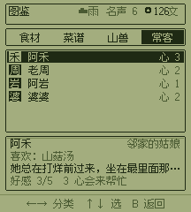
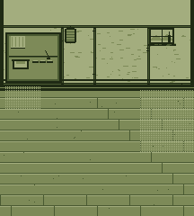
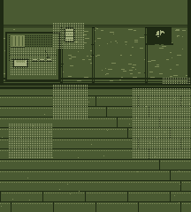
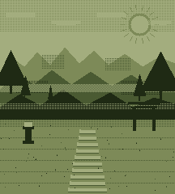

# 山脚小馆：UI、美术管线与平衡

状态：**设计草案 + UI kit 第一版已落地**（2026-10-27）。
范围：`registry/apps/shanjiao-diner`。平台结论部分也适用于其他 lo-game 游戏。

---

## 0. 先回答三个问题

**“lopda 和 3D 模块是不是满足不了正规游戏开发？”**
不是。至少对这个游戏不是。4 色、216×240 是美术风格，不是能力上限；512 KB 足够放十几张
全屏 2bpp 背景图；lo-game 的场景、输入、对话、存档、音乐已经够这个类型用。真正缺的是三样
*生产层*的东西，而不是引擎：

1. 没有布局/控件层，所以每个屏幕都在手写 `x=100, y=174`，一改文案就撞车；
2. 没有图片资产管线，所以只能用 `g.rect` 一行行画，细节和构图都上不去；
3. 没有平衡模拟，所以“房租/打怪/菜单/常客”只能靠手感，数值一改就全乱。

**3D 模块（lo-3d）不是这个游戏缺的那块。** 它是 160×144 的软件光栅器，负责低多边形、
点光、雾、抖动，不做输入、场景、碰撞、文字，也不做贴图美术。用它做俯视小馆会把美术成本
翻几倍，还会丢掉现在的手绘味。它适合 `镇妖塔` 那种“看一座塔”的展示型游戏。

**所以建议：留在 lo-game，补一层薄的生产层。** 不换引擎，不做通用引擎。

---

## 1. 平台预算（用数字说话）

| 项目 | 数值 |
|---|---|
| 画布 | 216 × 240 = 51,840 像素 |
| 全屏背景，2 bit/像素 | 12,960 B 原始；base64 约 17.3 KB |
| 12 张全屏背景，未压缩 | 155 KB 原始；base64 约 207 KB |
| 现在 `index.html` | 187 KB（含 17 个 src、567 字库、lo-game） |
| 512 KB 上限下可用的图 | 8–12 张全屏 plate（压缩后每张 3–8 KB），或 30–50 张半屏/局部图 |
| 全屏 blit | 51,840 次/帧；60 fps 约 310 万次/秒，和现在几百个 `rect` 同一量级 |
| lo-3d 展示预算 | 约 3000 三角形 + 10 点光，桌面 4–5 ms/帧；这是给“3D 展示”的，不是给 UI 的 |

结论：**图片不是放不下，是不会自动变好看。** 需要“plate + 动态层 + 实时文字”的分层做法，
而不是把整屏（含文字）当一张图。

---

## 2. UI framework

### 2.1 问题

现在的屏幕是“想到哪画到哪”：

- header 用固定 x：`74 / 89 / 112 / 166 / 176 / 202`。钱到四位数就压到“文”；
- 服务界面把订单气泡画在桌子上方，第二排气泡直接压在第一排桌上；
- 打烊右栏“第七天，山神宴。”从 x=126 开始，8 个字 96 px，超出 216；
- 备菜/店铺的长描述没有裁剪，换行就盖住下一行；
- 没有“这个屏幕有哪些区域”的概念，所以没人能检查重叠。

这些不是“画得不够多”的问题，是**没有布局所有权**。

### 2.2 五条带

所有屏幕共用同一副骨架（`src/30-ui.js` 的 `UI.R`）：

| 区域 | x | y | w | h | 用途 |
|---|---|---|---|---|---|
| header | 6 | 4 | 204 | 24 | 标题 / 天气 / 名声 / 钱 |
| body | 6 | 32 | 204 | 158 | 这个屏幕唯一的正事 |
| action | 6 | 194 | 204 | 22 | 这个屏幕能按的键 |
| footer | 6 | 224 | 204 | 12 | 一行按键说明 |
| margin | 6 | — | — | — | 左右安全边 |
| grid | 4 px | — | — | — | 所有间距取 4 的倍数 |

规则：

- 一个屏幕只有一个主体；主体放不下就滚动/分屏，不往 header 里塞；
- footer 只写这个屏幕真的能用的键（`sdk/UI.md` 第 5、6 节）；
- 选中态永远是反色，不是细边框；
- 所有文字走 `UI.text(..., {fit})`，不允许裸 `g.text` 长文案；
- 所有右对齐走 `UI.right`，从右边缘往左量，钱再多也不会压字。

### 2.3 已有的控件

| 控件 | 作用 |
|---|---|
| `UI.header(g, s, title)` | 右簇从右往左量：钱 → 名声 → 天气 → 标题裁剪 |
| `UI.text / UI.right / UI.ellipsis` | 测宽、省略号、裁剪；中文按字裁 |
| `UI.columns(g, y, cols)` | 一行多列，每列有自己的宽度和 clip |
| `UI.list(g, o)` | 滚动列表：窗口、光标、滚动、▲▼ 都由 kit 管 |
| `UI.actionBar(g, items, sel)` | 按钮按数量均分，反色选中，disabled 变暗 |
| `UI.orderTag(g, x, y, label, frac, sel, n)` | 桌上订单：菜名 + 桌号 + 耐心条 |
| `UI.panel / UI.bar / UI.toast` | 面板、进度条、提示 |
| `UI.debug(g)` | 画出三条带和 4 px 网格，用来抓越界 |
| `UI.help` | 说明页 |

### 2.4 这一版实际改了什么

- **header 重新排版**：钱、名声、天气从右边缘往左量，四位数也不会压“文”；标题按剩余宽度裁剪。
- **服务界面重排**：桌子从 `y=116/162` 改到 `y=94/168`；订单不再画在桌上，而是放到
  上排的墙带（`y=50`）和下排的空隙（`y=124`），每张 52×16：菜名 + 桌号 + 耐心条。
  服务模式不再画“酒”卷轴、“今日”板、货架——那块墙现在归订单。
- **备菜/店铺**：列表迁到 `UI.list` + `UI.columns`，光标、滚动、▲▼ 由 kit 管；
  备菜的材料行从 7 个看不清的图标改成两行“山菇 6　河鱼 3…”的文字。
- **打烊**：账本行用 `UI.columns`；“第七天 山神宴”限制在 78 px 内。
- **提示条**：`UI.toast(g, y)` 可指定 y；服务界面放在 `y=30`，不压桌子和订单。
- **页脚**：`UI.footer` 先铺一条 20 px 的纸带，夜间/木地板上也能读。
- **调试**：SELECT 切换 8 px 网格和三条带，所有场景自动生效。
- **图鉴**：早市「图鉴」或后山 START。四页：食材（哪里找 / 用于哪些菜）、
  菜谱（类型 / 材料 / 解锁 / 做法）、山兽（HP / 攻击 / 掉落）、常客（喜欢 / 好感 / 提示）。列表用 1 个字的
  字块（菇/鱼/米/笋/菜/肉/珍、汤/饼/饭/鱼/肉/煲/羹、猪/猴/竹/魈），
  因为 12 px 的食材 sprite 在 1x 下看不清。
- **后山**：走到食材/山兽旁边会浮出名字，不用先踩上去才知道是什么。



### 2.5 下一步

1. 把早市、备菜、店铺、打烊四个屏幕迁移到 `UI.list` / `UI.columns`，删掉剩下的魔法数字；
2. 加 `UI.modal`（确认框）和 `UI.notebook`（常客手册），替换 `game.choose` 的临时面板；
3. 加一个 SELECT 长按开/关 `UI.debug` 的调试开关（只在 `sdk/dev.html` 生效）；
4. 等三个游戏都用同一套，再考虑把它提成 `sdk/lo-ui.js`。现在不要动 `sdk/lo-game.js`：
   它有 hash 校验和发布流程，游戏内先迭代更快。

---

## 3. 美术管线

### 3.1 结论

**“多生成图再降到 4 色”方向对，但不能把整屏（含字）当一张图。**
正确做法是：

```
AI/手绘构图  →  4 色量化  →  分层 plate  →  运行时拼装
  432×480        216×240        bg/mid/actor/fx/ui      实时文字 + 动画
```

如果整屏烘焙：字会糊、位置会对不上、改一个字要重出图，正好是现在“位置对不上”的放大版。

### 3.2 管线

1. **构图**：按 216×240 出一张（或 432×480 再缩），只画场景，不画 UI、不画字、不画招牌字。
   提示词方向：`game boy style, 4 tones, 216x240, top-down/three-quarter view, big shapes,
   strong silhouette, one light source, no text, no UI, no logo`。
2. **量化**：亮度 → 4 个色阶（`#1f2a14 / #4a5a32 / #7d8a58 / #a3ad7e`），
   用 2×2 Bayer，不用 4×4（4×4 在 216 宽上会起噪点）。大面积保持纯色，
   抖动只给光晕、雾、墙面渐变。
3. **清理**：把人物、桌子、门、灶台的轮廓补成 1 px ink；把“AI 细节”删到能读；
   检查 3 个值是否分得开（ink 当剪影、dark 当阴影、paper 当受光）。
4. **打包**：2bpp，按行 RLE，base64 进 `src/plates.js`；运行时解成 `LoGame.sprite` 缓存。
   一张全屏 3–8 KB，12 张 40–100 KB。
5. **分层**：`bg`（墙/地/远景）→ `mid`（柜台/桌/门）→ `actors`（人/怪）→ `fx`（蒸汽/雨/灯）
   → `ui`（订单/按钮/文字）。动态层继续用现在的代码画，不要烘焙。
6. **预算**：先做 3 张垂直切片：小馆白天、小馆打烊、后山。每张不超过 8 KB，
   在 iPhone SE 上 60 fps，再加到 8–12 张。

### 3.3 已落地的工具（第一版）

`tools/art-shanjiao.mjs` + `tools/art-shanjiao-scene.js` 已经生成三张 plate：

```
node tools/art-shanjiao.mjs      # 需要 Playwright；写 src/25-plates.js 和 drafts/plates/*.png
```

| plate | 用途 | 打包后 |
|---|---|---|
| `roomDay` | 早市 / 服务 | 5.0 KB |
| `roomNight` | 打烊 / 夜间事件 | 9.7 KB |
| `mountain` | 标题 / 战斗 | 9.8 KB |





格式：216×240、2bpp、一字节一个 run（6 位长度 + 2 位色），base64；
`src/25-plates.js` 里的 `plateSprite` 只解码一次，`ART.plate` 用 `g.sprite` 画。
三张一共 34 KB 源码，`index.html` 从 187 KB 到 221 KB，离 512 KB 还很远。

动态层留在代码里：桌子、人、猫、蒸汽、雨、灯笼光晕、卷轴和“今日”牌。
服务模式不画右侧货架，把墙带让给订单。

**如果以后要吃外部 PNG**，再加一个 `tools/pixelize.mjs`：`--size` / `--dither` /
`--out` / `--preview`，输入任意图，输出同样的 RLE。现在三张图是代码画的，
所以这一步可以等第一张 AI/手绘图真的进来再做。

### 3.4 美术方向

- 一个主光源：白天是门/窗，晚上是灯笼和灶火；其余压暗。
- 人物保持现在的 2 倍大（`ART.big`），但轮廓要更清楚：ink 描边 + 1 个中间调。
- 小馆要有“层”：门框、帘子、柜台、灶、桌、凳、酒坛、猫。现在这些都有，但都挤在同一深度。
- 山道要有“深”：近景树/石、中景路、远景雾；雾用 dither，不用灰。
- 参考方向：Game Boy Camera 的颗粒、90 年代日式食堂的手绘招牌、4 色而不是 1-bit。

---

## 4. 平衡

### 4.1 工具

```sh
node tools/sim-shanjiao.mjs --runs=300
node tools/sim-shanjiao.mjs --policy=bossrun --trace
```

它直接读 `src/10-data.js`，不复制菜谱；模拟 7 天的采、打、做、卖、交租。
它假设“完美上菜、不走路、不演剧情”，所以数字是**上界**；用来找曲线问题，不替代试玩。
`--trace` 打一局逐日流水。

### 4.2 补丁前 / 补丁后的数字（300 局/策略）

前五行用 `node tools/sim-shanjiao.mjs --before --runs=300` 复现（山魈 72、3 体力、篮子 8、
山神羹可被路人点）；最后一行是当前仓库的最小补丁 + 谨慎玩法
（`--policy=tuned`：4 体力、篮子 10、山魈 44、磨刀石、采山珍、备三道菜）。

| 策略 | best | good | normal | bad | 第 4 天钱 | 第 7 天钱 | 客/天 | 走/天 | 缺菜/天 | 将就/天 | 名声 | 山魈胜 | 欠租 |
|---|---|---|---|---|---|---|---|---|---|---|---|---|---|
| 不升级，只做菜 | 0% | **56.7%** | 43.3% | 0% | 158 | 275 | 4.0 | 1.4 | 1.0 | — | 4.4 | 0% | 0% |
| 先保租，买灶/刀 | 0% | 61.3% | 38.7% | 0% | 84 | 177 | 3.7 | 1.3 | 1.0 | — | 4.1 | 0% | 0% |
| 先买招牌，多来客 | 0% | 47.7% | 51.0% | **1.3%** | 59 | 86 | 3.9 | 1.7 | 1.3 | — | 2.7 | 0% | 1.3%/1.3% |
| 房租优先，之后升级 | 0% | 68.3% | 31.7% | 0% | 109 | 203 | 3.7 | 1.4 | 1.1 | — | 4.4 | 0% | 0% |
| 第六天打山魈 | 0% | 44.0% | 54.3% | 1.7% | 64 | 73 | 3.5 | 1.6 | 1.2 | — | 2.4 | **0%** | 0.3%/1.7% |
| 第三刀：需求 + 常客 + 名声/2 + 招牌小费 + 宴席保护 | **34.3%** | 65.3% | 0.3% | 0% | 80 | 200 | 4.6 | 2.2 | 0.0 | 2.6 | 8.8 | **99.3%** | 0%/0% |

“客/天”是整局平均每天服务人数；“走/天”是每天流失；“缺菜/天”是因为点的菜卖完而流失。
最后一行是第三刀：第二刀的名声/招牌/宴席保护，加上“每天固定想吃”和常客图鉴。
best 从 4.7% → 37.7% → **34.3%**，落在 4.4 的 25–40% 目标里；good 65.3%，normal 0.3%。
“将就/天” 2.6 是新机制：客人想吃的类别菜单里没有，就点别的菜，照吃但少 1 文小费。
走/天 2.2，仍主要发生在第 6 天打山魈和第 7 天备三道菜；模拟里每天把食材做完，
不会给后面留菜，真人可以留。

**现在的分布是：做完山神宴的谨慎玩法 best 34.3% / good 65.3%；不碰山魈、不做宴席的
`casual` 是 normal 100%；只做一部分的 `shopkeeper` 是 good 37% / normal 63%。**
三条路能读出不同的结果，不再是谁都“good”。

### 4.3 六个结构性问题

1. **房租不是威胁。**
   正常玩法 0% 欠租；`casual` 56.7% good、43.3% normal。七天总租 250，起始 80，
   日均 4 个客人 × 8 文就能覆盖。“最后七天”的压力没有落到数值上。

2. **升级是负收益。**
   不升级的 `casual` 第 7 天 275 文、57% good；买灶/刀的 `shopkeeper` 177 文、61% good；
   买招牌/长凳的 `expand` 只有 86 文，还有 1.3% 破产。
   原因：升级花掉的是房租钱，而“多来客人”没有增加食材供给，只增加了流失。
   招牌目前是**陷阱**。

3. **山魈打不过，best 结局不可达。**
   山魈 72 HP / 6 atk / 每三回合 9–13；主角 30 HP / 6 atk（磨刀石 8）/ 3 气。
   最优出刀约 4–5 回合打 30–50 点，山魈 5 回合内打死主角。模拟胜率 0%。
   而 best 需要 `boss + ahe≥4 + vip≥3 + rep≥8`，所以 best 恒为 0%。

   把山魈改成 44 HP / 6 atk 后，单挑胜率：**有磨刀石 86%，无磨刀石 4%**；
   第 6、7 天各有一次机会，所以整局至少赢一次 98.7%。山魈从“不可能”变成“要不要为它花 60 文”。
   最小补丁后 best 仍只有 4.7%，说明“能打山魈”不等于“能拿 best”；第二刀才把名声和宴席菜补上。

4. **供给和需求对不上，名声越高越难。**
   补丁前 3 体力 / 篮子 8；第一刀后 4/10；第三刀后名声涨得更快，整局平均走 2.2/天、
   缺菜 1.8/天，主要压在第六天打山魈和第七天备三道菜。
   不是总量差很多，而是“点的菜卖完、别的菜还在”：单菜菜单让 appeal 失效，多菜菜单
   又让路人把某一道吃光。名声每 3 点 +1 客人，供给却不变 → 名声成了惩罚。
   需要：① 菜单里有一道便宜主食兜底；② 第 7 天留菜；③ 名声涨客要慢于供给。

5. **“顾客喜欢吃啥”已经接上，但还比较浅。**
   - 每天早上固定一队“想吃”：汤/饼/饭/烤/炒/煲，早市第三行会写数量；
   - 菜单里有对应类别的菜 → 客人点它，+1 文小费；没有 → 点别的菜“将就”，
     照吃但少 1 文；第 7 天的三道宴席菜仍然只给 VIP；
   - 常客 fav 现在真的影响点单（他们的订单优先是 fav），上对菜还会 +1 心；
   - 下一步可以按天气/常客把需求再偏一点，或让“将就”影响名声而不只是小费。

6. **结局现在按“宴席完成度”分，不再按名声分。**
   bad = 欠租；best = 3 VIP + 阿禾 4 心 + 名声 10 + 最后选择“端给阿禾”；
   good = 2 VIP（供山神庙或端给阿禾）；normal = 活下来但没办成宴席。
   这解决了“casual 名声 11.4 也 good”的问题：不碰山魈/不做宴席就是 normal。
   代价是 `normal` 对谨慎玩家只有 0.3%，因为三道菜一旦端上就至少 2 VIP。

### 4.4 建议的调参方向（先模拟，再改数据）

| 项 | 现在 | 建议 | 理由 |
|---|---|---|---|
| 一趟山 | 4 体力 / 篮子 10（已打补丁） | **5 体力，或第 5 天起每天 2 趟** | 第三刀后仍走 2.2/天；先解决菜单结构，再看总量 |
| 客人上限 | 9，名声/3 | **8，名声/4** | 让名声是奖励，不是惩罚 |
| 招牌 | +1 小费（已打第二刀） | **保留** | 不再是纯陷阱，也不再增加食材压力 |
| 菜单/需求 | 单菜最优、多菜会缺 | **每类菜有保底需求，常客 fav 加权** | 让“顾客喜欢吃啥”成立 |
| 第 7 天 | 三道菜只给客人（已打第二刀） | **保留；可加订单标记** | 路人不再吃掉山神羹/烤河鱼/山菇汤 |
| 灶台 | 80 文 | 60 文，解锁鱼/肉 | 2–3 天回本 |
| 磨刀石 | 70 文，+2 atk | 60 文，+2 atk | 山魈的钥匙 |
| 腌菜坛 | 50 文 | 40 文，退 1–2 份 | 减少“做多了浪费”的惩罚 |
| 长凳 | 120 文 | 90 文 | 现在太贵 |
| 山魈 | 44 HP / 6 atk（已打补丁） | **保留 44；或 46 增加紧张感** | 单挑：有刀 86%，无刀 4%；两天各一次机会 |
| 主角 | 30 HP / 3 气 | 32 HP / 3 气（或山神泉 +4 上限） | 给一次容错 |
| 山神羹 | 只给山神宴/剧情点（已打补丁） | **保留，并给 VIP 留菜/先到** | 否则还是会被路人吃掉 |
| 便宜主食 | 山菇汤 8 文 / 2 菇 | **6–7 文 / 1 菇**，或加“清汤” | 现在的默认菜是性价比最差的 |
| 结局 | best=3VIP+ahe4+rep10+端给阿禾；good=2VIP（已打第三刀） | **保留；normal 只留给没办成宴席的局** | best 34.3%，good 65.3%，normal 0.3% |

目标（300 局）：

| 指标 | 谨慎玩家（做完宴席） | 普通玩家（不碰山魈） |
|---|---|---|
| 欠租 | < 5% | < 5% |
| 缺菜/天 | 1.5–2.5（第 6/7 天集中） | 1–2 |
| best | **25–40%** | 0% |
| good | 50–65% | 25–40% |
| normal | < 5% | 55–75% |
| bad | < 3% | < 3% |
| 无磨刀石打山魈（单挑） | < 10% | — |
| 有磨刀石打山魈（单挑） | 80–90% | — |

### 4.5 剧情和平衡的接口

- 常客 fav 上菜 → +1 心 + 1 个小故事，而不是只在第 7 天判定；
- 每个常客 3 心解锁一个“夜话”，给一个菜谱/升级/食材；
- 打烊账本写“谁来了、谁没来”，让数值有脸；
- 第 7 天三道菜要**预留**：山神羹、烤河鱼、山菇汤各 1 份，VIP 先到或订单带标记。

---

## 5. 剧情

现在的文本功能上够用，但更像“系统提示”：阿禾、老周、阿岩、婆婆各两句话，
山神是一个事件，不是一个角色。建议改成三幕，主题是**“留灯”**。

### 5.1 三幕

**第一幕（1–3 天）：重新开灯。**
小满接过小馆。每个常客带着一种“饿”来：
- 阿禾：想再喝一口娘做的山菇汤（她娘是谁？先不说）；
- 老周：河里的鱼越来越少，他带来的是最后几条；
- 阿岩：山要封了，猎户要走了；
- 婆婆：地契在她手里，初四收租。

**第二幕（4–5 天）：灯要灭了。**
房租、陆先生、山神宴撞在一起。陆先生的评价不是奖励，是一面镜子：
他吃得出“山气”，也吃得出“赶工”。玩家第一次要在“多接客”和“留一份给谁”之间选。

**第三幕（6–7 天）：山神宴。**
后山深处，山魈守着山珍。真相：山神宴不是给山神的，是给小满娘——她是上一任掌勺，
山神是她的第一位客人。最后的选择：
- 把山神羹供在山神庙：镇子保住了，小馆没了；
- 把山神羹端给小馆里的人：小馆保住了，山神那边空着一席。
best 不是“都赢”，而是“灯还亮着，人还在”。

### 5.2 台词规则

- 一页 1–2 句，具体名词和动词，不讲设定；
- 每个常客一个口头习惯：阿禾用问句，老周说鱼，阿岩说刀/山，婆婆说钱/日子；
- 食物写触感：汤面上的油、鱼皮的脆、笋的涩、米饭的蒸汽；
- 沉默也是台词：`["……", "汤要凉了。"]` 比解释有效。

### 5.3 结局卡（具体画面，不写数字）

- **best 灯还亮着**：阿禾在门口收伞，新招牌，猫在灶边，雨停了。
- **good 汤还热**：常客坐满一桌，账还清，山门关了，锅里还热。
- **normal 账清了**：空椅子，灶是温的，明天还得早起。
- **bad 火种**：招牌被摘，灶里还有一点红，一只手把火重新拨亮。

---

## 6. 建议的施工顺序

| 步骤 | 内容 | 验收 |
|---|---|---|
| 1（已做） | UI kit + header + 服务订单 + 溢出修复 | `check-app` 过；216×240 无重叠；四位数钱不压字 |
| 2（已做） | 四个屏幕迁移到 `UI.list/columns`；调试网格；图鉴 | 截图前后对比；iPhone SE 可读 |
| 3（已做） | 3 张 plate（小馆白天/打烊、后山）+ SELECT 调试网格 | 5.0/9.7/9.8 KB；221 KB；不烘焙文字 |
| 4（已做） | 第三刀（需求/常客/名声/招牌/宴席）+ 模拟复跑 | best 34.3%，山魈 99% |
| 5（第一版已做） | 剧情三幕 + 常客图鉴 + 结局卡 + 最后一碗的选择 | 3 次完整试玩，能说出每个常客的“饿” |

先做 3 张图，不要一次做 12 张；先证明“plate + 动态层”比现在的代码画法好看，
再决定要不要全量换。

---

## 7. 需要 owner 拍板

1. **美术**：AI 出构图 + 手工清理，还是全手绘？我建议前者，AI 只做构图/光影参考。
2. **色调**：保持这台的绿色 4 色，还是给小馆一套暖色 4 色？我建议保持平台色，靠明暗和构图做氛围。
3. **平衡**：best 结局难度的目标是多少？我建议 300 局里 25–40%，不要做成 100%。
4. **剧情**：娘/山神/第一任客人这条线，要不要这么重？如果要轻一点，可以把山神改成“山里的老客”。
5. **范围**：先做 3 张垂直切片，还是一次做 8–12 张？我建议 3 张。
